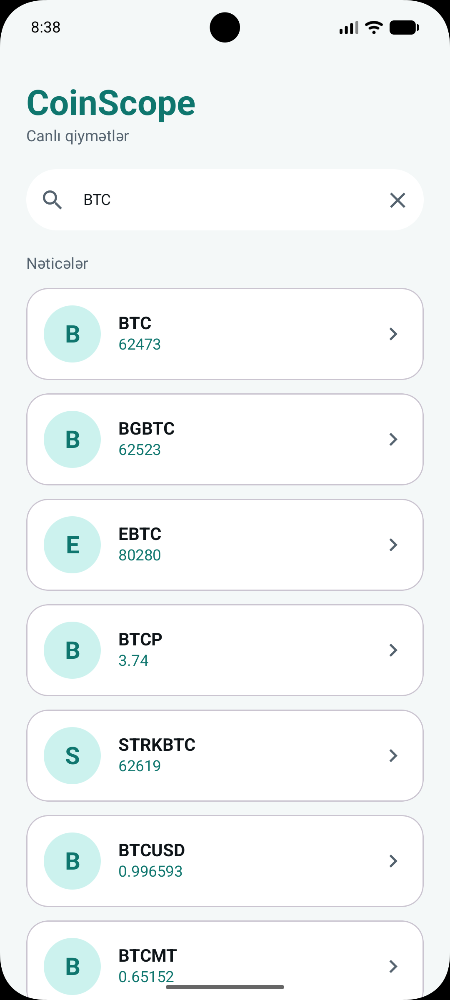
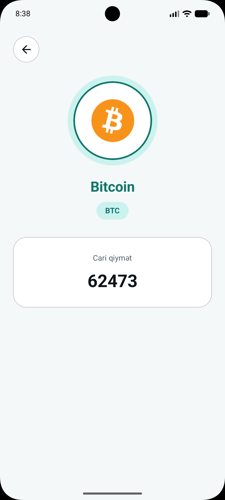

# CoinScope

A cryptocurrency price tracker for Android, built with Jetpack Compose and powered by the [CoinGecko API](https://www.coingecko.com/en/api).

<p align="center">
  
  
</p>

## Features

- Live coin prices from the CoinGecko API
- Search with debounce (works for small coins outside the top 100 as well)
- Coin detail screen with logo, name, symbol and current price
- Loading, error (with retry) and empty-result states
- Dark theme with a custom color palette and typography

## Tech Stack

- **Language:** Kotlin
- **UI:** Jetpack Compose, Material 3
- **Architecture:** MVVM with data / domain / presentation layers
- **Dependency Injection:** Hilt
- **Networking:** Retrofit, Gson
- **Async:** Kotlin Coroutines, StateFlow
- **Navigation:** Navigation Compose
- **Image loading:** Coil
- **Dependency management:** Gradle version catalog

## Architecture

```
app/src/main/java/com/example/coinscope
├── data
│   ├── remote        # Retrofit API and DTOs
│   ├── mapper        # DTO -> domain mapping
│   └── repository    # Repository implementation
├── domain
│   ├── model         # Coin model
│   └── repository    # Repository interface
├── di                # Hilt modules
├── presentation
│   ├── list          # Coin list screen, ViewModel, components
│   ├── detail        # Coin detail screen, ViewModel
│   └── navigation    # Navigation graph
└── util              # Helpers (price formatting)
```

Key decisions:

- The UI depends on a domain `Coin` model, not on API DTOs, so API changes stay in the data layer.
- Search is debounced (500 ms) and uses `collectLatest`, so outdated requests are cancelled. This also helps with CoinGecko's free-tier rate limit.
- Repository calls return `Result` and rethrow `CancellationException`, so coroutine cancellation is never swallowed.

## Getting Started

1. Clone the repository
   ```
   git clone https://github.com/22eminn/CoinScope.git
   ```
2. Open it in Android Studio
3. Sync Gradle and run the app on an emulator or device

No API key is required. The app uses CoinGecko's public endpoints, which have a rate limit, so very frequent requests may temporarily fail. The app shows an error state with a retry button in that case.

## Possible Improvements

- Price chart for the last 7 days
- 24h price change indicator
- Local caching with Room
- Unit tests for ViewModels and repository